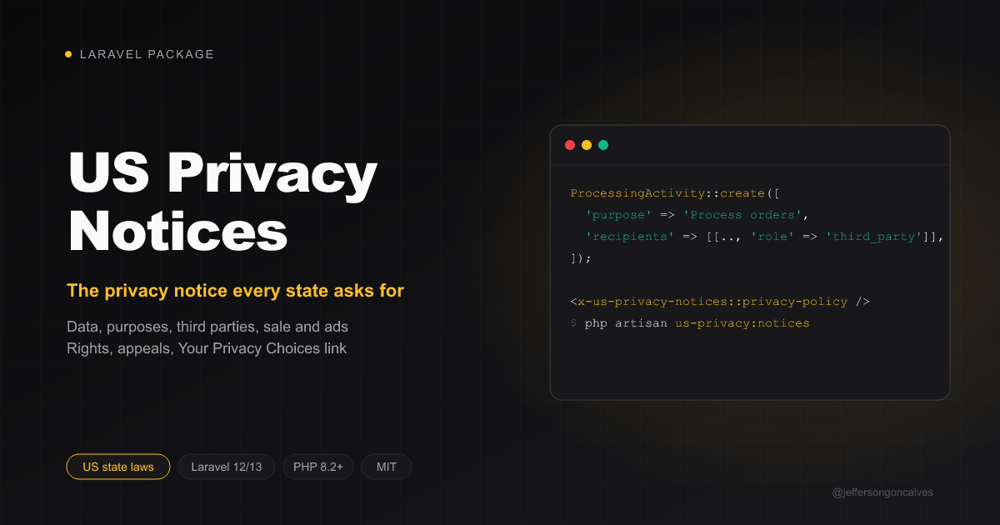

# Laravel US Privacy Notices



[](https://packagist.org/packages/jeffersongoncalves/laravel-us-privacy-notices)
[](https://github.com/jeffersongoncalves/laravel-us-privacy-notices/actions/workflows/tests.yml)
[](https://packagist.org/packages/jeffersongoncalves/laravel-us-privacy-notices)

The privacy notice the US state privacy laws require, built from your processing activities and the personal data you declared with [laravel-us-privacy](https://github.com/jeffersongoncalves/laravel-us-privacy). Every state asks for the same core disclosures:

- the categories of personal data you process, and the sensitive data among them;
- the purposes;
- the categories you share with third parties, and those third parties;
- whether you sell personal data or process it for targeted advertising or profiling, and how to opt out;
- how consumers exercise their rights, and how they **appeal** a refusal.

> This package gives you tooling. It does not make you compliant on its own: have the notice reviewed.

## Installation

```bash
composer require jeffersongoncalves/laravel-us-privacy-notices
php artisan vendor:publish --tag="us-privacy-notices-migrations"
php artisan vendor:publish --tag="us-privacy-notices-config"
php artisan migrate
```

Set the business in `config/us-privacy-notices.php` (`name`, `contact`, `requests_url`).

## Processing activities

```php
use JeffersonGoncalves\UsPrivacyNotices\Models\ProcessingActivity;

ProcessingActivity::create([
    'name' => 'Checkout',
    'purpose' => 'Process orders and payments',
    'consumers' => ['customers'],
    'data_categories' => ['contact data', 'purchase history'],
    'models' => [App\Models\Customer::class], // their #[PersonalData] columns
    'sources' => ['directly from you'],
    'recipients' => [
        ['name' => 'Stripe', 'role' => 'processor'],
        ['name' => 'AdNetwork', 'role' => 'third_party'],
    ],
    'retention' => '5 years after the last order',
]);
```

Recipient roles: `processor`, `third_party` and `affiliate`. Third parties and the categories shared with them go into the notice. Whether you sell, target ads, profile or process sensitive data comes from the `sold`, `targetedAdvertising`, `profiling` and `sensitiveType` flags of your `#[PersonalData]` columns.

## The notice

```blade
<x-us-privacy-notices::privacy-policy
    requests-url="/privacy/requests"
    choices-url="/privacy/choices"
    consent-url="/privacy/sensitive-data" />
```

English and Spanish ship; publish the translations to change the text. The "Your Privacy Choices" link shows only when you sell personal data, target ads or profile, and the consent link only when you process sensitive data:

```blade
<x-us-privacy-notices::privacy-choices choices-url="/privacy/choices" consent-url="/privacy/sensitive-data" />
```

Pair them with [laravel-us-privacy-opt-out](https://github.com/jeffersongoncalves/laravel-us-privacy-opt-out) for the choices and consent, and [laravel-us-privacy-requests](https://github.com/jeffersongoncalves/laravel-us-privacy-requests) for requests and appeals.

```php
use JeffersonGoncalves\UsPrivacyNotices\Facades\UsPrivacyNotices;

UsPrivacyNotices::export();          // everything the notice discloses
UsPrivacyNotices::needsOptOutLink(); // sells, targets ads or profiles
```

```bash
php artisan us-privacy:notices          # table and reminders
php artisan us-privacy:notices --json
```

## Testing

```bash
composer test
```

## Changelog

See [CHANGELOG](CHANGELOG.md).

## License

The MIT License (MIT). See [License File](LICENSE.md).
